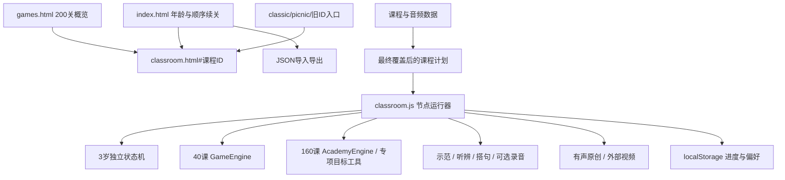
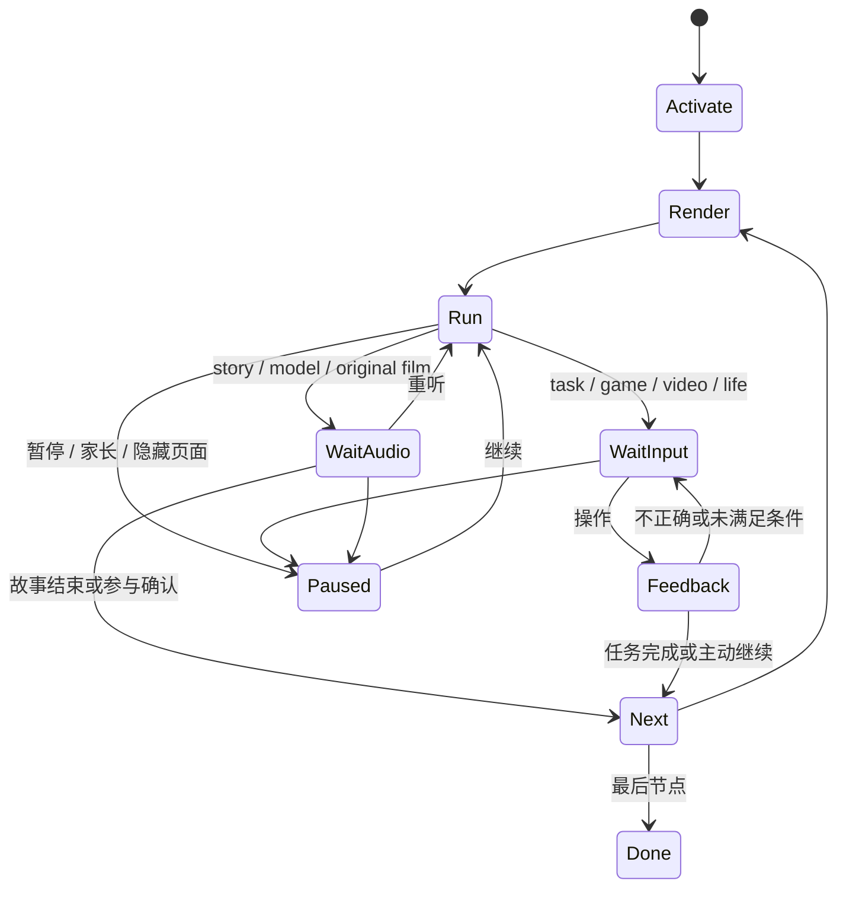

# 小小奇遇岛技术设计文档

版本：expansion100-v1（2026-10-29）；原版课堂：V2.8 / age-video-v1；文档修订：2026-10-28；播放器补丁：official-embed-v1；交互/布局补丁：ipad-fit-v1；学习交互补丁：learning-variety-v1；状态：当前运行基线。

产品与逐关内容以 [PRD](PRD.md) 为准。本文说明如何实现、维护、验证和发布；仓库约定见 [AGENTS.md](../AGENTS.md)。基线应用提交为 `1ee4018d8765ab168b7e42a64e2e16f938e1a8f0`。后续官方嵌入补丁按用户对照结果调整播放器；课程与音频基线保持不变。

## 增量：奇遇小屋（reward-play-v1）

room.html独立承载小屋与四种活动；island-rewards.js以稳定课程ID映射礼物并在课堂finish后幂等授予，room-art.js提供原生SVG场景/道具，room.js负责房间状态、收藏和原生dialog活动。课堂使用独立island-rewards.css，不能引入小屋全局样式。BFS寻找上下左右连通的路，动物用CSS坐标过渡沿路移动；音乐以Web Audio振荡器合成四个音，点按触发AudioContext，关闭/隐藏页面停止全部声音及异步计时器。故事存结构化图片组合，不上传声音或图像。

现有v3本机记录增加rewards.version=1、earned[courseId]、placements[{id,x,y}]和roomPlay={version:1,care,routes,music,stories}。房间最多5动物/8物品，位置百分比，音符16个，故事12种。常驻guest伙伴不占课程奖励。小屋save读取最新课程记录以保护其他标签里的新进度；IslandRewards.importData对家长导入的课程ID、坐标、音符、故事组合做范围校验并去重。完成/参与只表示路径证据，不代表知识掌握。课程节点、原音色、原状态键不变。验收与当前边界见[奖励小屋规格](REWARD-ROOM.md)。

## 1. 架构与运行边界

这是直接发布的静态 Web 应用，采用 HTML、CSS、普通 JavaScript、SVG/Canvas 和预生成 MP3。没有生产 Node/Python 服务、数据库、登录账户、运行时 TTS、ASR 或发音评分。家长记录保存在当前来源的浏览器存储中，外部视频从 YouTube 官方嵌入播放器加载。



外部视频、首次下载资源需要网络；没有 Service Worker 离线包机制。下载资源后浏览器可能缓存，但不能据此承诺完整离线使用。音频制作在开发机器完成，MP3 是生产资源，模型和 WAV 母带不属于站点。

## 2. 目录和路由

|位置|职责|
|---|---|
|`index.html`、`assets/academy.js`|选择年龄、顺序续关、课程介绍、家长记录与导入导出|
|`classroom.html`、`assets/classroom.js`|当前统一课堂与五阶段节点运行器|
|`games.html`、`assets/classroom-catalog.js`|最终覆盖后的200关任务、英语与配片概览|
|`classic.html`、`picnic.html`|历史/样板入口及兼容跳转，不是新增课程的主入口|
|`video-library.html`、`watch.html`|早期素材浏览/播放辅助页；不能替代当前逐关显式配片表|
|`assets/`|数据、规则、视图、CSS、角色素材和MP3|
|`docs/PRD.md`|产品规范与200关、1000环节详细需求|
|`docs/TECHNICAL.md`|本文，技术维护主文档|
|`AGENTS.md`|代理及开发者必须保留的项目约定|
|工作区 `release/v2/test/`|生成、抽取、验证、发布脚本、报告、母带与模型，生产目录之外|

主路由为 `classroom.html#P05-01`。课程ID格式为 `P` + 两位年龄 + `-` + 两位关号；年龄3—12、关号01—20。运行器也接受 `course-`、`learn-`、`result-` 前缀。首页保留旧课ID映射至 `existingCourseId`，不能因改标题或课程排序而重建ID。

`?v=age-video-v1` 用于新版本入口与缓存识别，不代表新的学习记录命名空间。部署子路径是 `/little-wonder-island/`，资源使用站点内相对路径，不能写死根路径 `/assets/`。

## 3. 数据层与覆盖顺序

### 3.1 逻辑模型

|对象/全局|主要内容|维护原则|
|---|---|---|
|`ACADEMY.courses`|200关的ID、年龄、顺序、标题、科目、概念、任务、英语、生活拓展、旧课映射|基础课程描述，不一定是最终课堂目标|
|`ACADEMY.modules[id]`|160个新课的题型、字段、卡片、棋盘、实验记录、提示、成功文案、素材和音频ID|由 AcademyEngine 和专项工具共同解释|
|`COURSES.lessons`|40个早期完整课的开场、教学、动作、回顾、旧规则配置|保留旧ID与原音频，不直接覆盖新的3岁交互|
|`CLASSROOM_PLAN[id]`|教学节点、主要英语目标、示范节点、英语游戏、主题与主工具|必须读取所有覆盖脚本执行后的结果|
|`CLASSROOM_EXPERIENCES.courses[id]`|按目标选择的玩法族、标签、年龄目标|不是200种完全不同基础规则的宣称|
|`CLASSROOM_VIDEO_MAP[id]`|每关明确的视频ID、标题、发布者、链接、用途和核验说明|200关完整覆盖；禁止关键词随机回退|
|`CLASSROOM_FILM_AUDIO`|200段原创旁白的文本、MP3、时长、引擎和哈希|字幕和当前真实音频使用同一条记录|
|`CLASSROOM_TODDLER_AUDIO` / `PROMPTS`|37条短指令、重试和鼓励，以及每关步骤映射|与3岁任务状态的当前步骤一致|
|`CLASSROOM_LANGUAGE_AUDIO` / `TARGETS`|104条升级目标引用及52关覆盖，含92条新生成和12条复用|保留已确认的英语音色；不修改旧MP3|
|`CLASSROOM_TRANSFER_FILMS`|200关历史三段拓展示例文字|当前有声原创只使用对应配音内容，不能把三段旧字幕当作三段已配音|

课程示例（字段结构示意，非运行时完整对象）：

```json
{
  "id": "P05-01",
  "age": 5,
  "sequence": 1,
  "title": "六份点心朋友来",
  "subject": "数学",
  "existingCourseId": "A5-01",
  "concept": "平均分 · 三等分：……",
  "task": "六份点心，三位朋友……",
  "english": "Three friends. / Two for each."
}
```

对象是可变全局，覆盖后 `course.english`、部分 `course.task` 与源文件初值不同。不得只读 `academy-data.js` 或旧教案就生成当前产品说明。

### 3.2 页面加载依赖

传统 `<script>` 按顺序执行，没有模块打包器。关键顺序如下：

1. 角色/旧课/旧音频、ACADEMY数据与音频。
2. 场景、实物图、分龄场景、棋类规则、两套规则引擎与动效。
3. 原视频库、播放器、英语提示与录音工具。
4. 统一视图、基础计划、旧原创图解与释义。
5. `classroom-experience-data.js` 按实际目标覆盖玩法与英语结构；案件资料、专项工具、英语高级任务。
6. 拓展数据与图解包装、规律图形修正。
7. 视频帮助、3岁交互模块、英语音频与 `classroom-language-plan.js` 覆盖。
8. 当前视频映射、200段原创音频、3岁提示音频、原创有声包装。
9. 最后执行 `classroom.js`，构造当前课程节点并开始运行。

目录页按自己的最小依赖加载，必须也应用3岁和英语计划覆盖，否则会展示旧任务。已有首页介绍页尚有旧口径，见第15节；不能以它覆盖最终课堂配置。

## 4. 节点运行器与阶段

### 4.1 可见阶段与内部节点

|group|低龄名称|高龄名称|节点kind|
|---:|---|---|---|
|0|听故事|问题与方法|`story`|
|1|动手玩|动手挑战|`task`|
|2|看短片|短片欣赏|`film`|
|3|说英语|英语任务|`model`、`en-game`|
|4|生活里试试|实践与回顾|`move`、`life`、`ending`|
|5|结束页|结束页|`done`|

可见五个阶段不等于五个节点。旧课开场、教学和结尾有多段；英语先逐目标示范，再运行游戏。3岁只激活一项听音游戏，保留其余兼容位置为 `skip`。历史 `film` 节点也保留位置，但当前选择的视频或有声小片段不再播放旧的F系列逐段台词；用户确认看完后跳到英语前一节点，再由 `next()` 进入英语。

### 4.2 生命周期



- `activate(id)`：取消旧任务，选择课程/引擎/计划，恢复记录并迁移，构造节点，归一化下标，渲染后运行。
- `stop()`：递增取消令牌 `token`、取消等待、暂停音频、清理录音和动效；不能省略。
- `play(id,t)`：按元数据设置音频地址和播放速率；只有同一令牌的结束回调能推进。缺资源、网络失败或自动播放拒绝分别显示可恢复提示。
- `wait(ms,t)`：保存剩余等待时间，允许暂停；不可用裸长计时替代。
- `repeat(id)`：每轮2遍，中间1200ms跟读间隔。游戏可能再次遇见同一目标；不是全关总计仅出现2次。
- `next()`：保存当前进度、跳过兼容节点、重置短片瞬时状态，再渲染/运行；阶段完成是路径记录，不是学业评价。
- 点击导航按 `group` 查找入口；停止旧音频/录音，不删除游戏摆法。
- 新课教学 `story` 的一个中文讲解clip播放后进入任务；任务通常再播放同一讲解clip。`module.script` 三段文字不等于当前已自动播放了三段课程。
- 旧课教学段结束后的自动衔接约450ms；结尾约700ms，规则成功的局部反馈/转换另有550—800ms等待，拖放约440ms后判定。

`run()` 的异步分支必须在播放/等待返回后检查令牌。跨阶段、重玩、视频切换、提示等改变运行上下文时，不能让旧回调继续落子、开麦或跳关。

## 5. 本机存储、恢复与迁移

### 5.1 存储键

|键|内容|
|---|---|
|`little-wonder-island-academy-v3`|年龄选择、每龄游标、200关状态和记录|
|`little-story-island-v2-20261024`|旧40课记录，兼容导入和完成映射|
|`little-wonder-island-preferences-v1`|原创/视频形式偏好，`film: song/original`|

主存储结构示意：

```json
{
  "version": 3,
  "selectedAge": 5,
  "cursor": {"5": "P05-01"},
  "muted": false,
  "courses": {
    "P05-01": {
      "stage": 4,
      "stages": {},
      "finished": false,
      "observation": "",
      "elapsed": 0,
      "english": {},
      "updatedAt": 0,
      "flow": {
        "version": 1,
        "index": 12,
        "experienceVersion": 2,
        "languageVersion": 3,
        "completed": [0,1,2],
        "english": {},
        "design": {},
        "slow": false,
        "packed": [],
        "game": {},
        "toddler": {}
      }
    }
  }
}
```

示意中的 `index` 不可硬编码到某一阶段。新课另有 `state.activity`，旧课有 `flow.game`；3岁专用 `flow.toddler`。`flow.design` 保存创作、线索、量杯、变量记录等专项状态。`previousEnglishGames` / `previousLanguageGames` 是升级归档；`externalVideo` 表示本课曾使用直达/复制入口，不等于平台确认看完。

### 5.2 续关算法

首页先找当前年龄游标指向且尚未完成的关卡；否则找本龄第一关未完成课程；本龄全完成则允许回顾第一关。课程内部由 `flow.index` 和具体任务状态恢复。改年龄不会清空其他年龄进度。

### 5.3 迁移约束

- 外层数据仍为version3，节点流version1。
- `experienceVersion=2` 曾归档非 `model-*` 的旧英语游戏记录。
- `languageVersion=3` 对4岁及以上归档数字键英语游戏记录，保留 `model-*` 示范参与记录、课程完成与阶段路径。
- 下标越界先钳制，再连续跳过 `skip`，兼容占位不能随意删。
- `finished=true` 表示走到结局，不等于必须重做升级课或已掌握；重新进入已完成任务保留结果并给重玩/继续。
- 重玩入口先freeze并明确showModal：已完成任务主按钮和家长菜单共用同一确认流程。确认后关闭dialog、解除暂停并stop取消旧回调；旧课重建round=0，新课重建activity；清空design/toddler/chainOrder和错误反馈，去掉动手阶段的完成标记，回到task节点并显示首轮。保留finished历史足迹、其他阶段、英语和其他课程。取消调用resume，不重建任务状态。

### 5.4 导入导出真实范围

首页导出JSON包含 `format: little-wonder-island-academy`、version3、导出时间、store、legacy。导入限制8,000,000字节，验证格式与已知课程ID，合并有效课程；观察最多1500字、流下标需0—99、活动数据按题型检查。错误文件不清空现有记录。

当前导入并非完整原样恢复所有导出字段：游标、偏好、旧课legacy和年龄选择不按备份逐字段恢复；偏好本来就单独存储。不能宣传云同步或完整设备镜像。`flow` 导入为兼容对象，后续修改应补充细粒度字段校验，不能任由未来结构无限透传。`elapsed` 是兼容字段，统一课堂不能据此宣称精确学习时长。

## 6. 动手任务实现与真实判定

### 6.1 分派优先级

1. `course.age===3`：`ClassroomToddler.render/act/voice`，覆盖源模块与旧引擎界面。
2. 其余存在旧课映射：`ClassroomViews.legacy` + `GameEngine`；规律视图由 `ClassroomPattern` 包装。
3. 新课：`ClassroomExperience.render` 优先；未覆盖的分数、比例地图、食物链使用专用界面；再回退 `ClassroomViews.academy`。
4. `ClassroomCases` 给部分判断题提供具体线索、实验条件、模拟材料及提交前验证。

### 6.2 3岁状态机

`flow.toddler` 独立保存step、选择、点画、轮流次数和done。输入来自 `data-t` 事件及SVG点位；状态更新后保存、渲染、播放当前短提示或反馈。操作内容与37条提示的对应表在PRD各课中。

- 两次顺序点选：大小、颜色、形状、天气、袜子、情绪等；错误不增加step。
- 任意表达选择：角色+动作、灯笼身体+流苏；不判审美或口语完整度。
- 点画花园：最多两朵；选择颜色不增加完成次数。
- 轮流：兔熊交替4次。
- 三枚石子排位、两步亮脚印、三次种花计数。
- 简单节奏：敲两下，不按时间或音量判分；听示范是合成提示音。
- 完成后手动继续；记录 `stages[2]=participated`，可用新课activity记reported，不伪造旧棋类题通过。

### 6.3 两个规则引擎

|模块|职责|关键条件|
|---|---|---|
|GameEngine|40课旧题型与分龄gameConfig|所有物品安排后比较份数/类别；图形按目标洞；选择题按答案集；路线按终点及取件点；计数精确目标；排序完整且顺序一致|
|AcademyEngine|160课的新题型基础状态、动作和判定|数值/分类/顺序/实验/电路/路线/程序/节奏/排错/棋类|
|ClassroomExperience|按目标设计工具与参与门槛|更新专项设计状态、触发check或complete，不替代所有基础规则|
|BoardRules|五子棋连线、候选、回应；象棋合法走法和应将|不将界面动画当作合法性依据|

`autoCheck()` 不在未完成摆放时直接判错：分配等先看物品是否全部有位置；排序先看数量；实验看观察/选择；计数到目标才确认。选择或完成摆放后立即给结果；新课高级判断通常显式点检查。

客观结果失败保留操作，更新反馈；成功后播放common-done，旧课若还有轮次则换下一轮，否则进入下一环节。重进已完成任务停留结果，有“重新玩这关/继续”。

### 6.4 新课判定清单

|题型|需要满足的当前条件|
|---|---|
|choice|选择在answers集合内；特定高龄案件还须先标出依据/固定变量|
|number|所有字段等于target；linear题则当前总票数=2×人数+1且试过至少两种人数，专项变量表还需两条不同人数的有效存档|
|sort|每张卡的assign等于卡片to；高龄可逐条改标签后检查|
|sequence|所有卡都出现、数量相等、索引顺序0…n-1；不允许空序列通过|
|experiment|打开至少minimum条观察记录且选择有效解释；预测只记参与不判对错|
|circuit|所有导线连接、开关闭合，且观察过通电和断电两种状态|
|route|到达target，若有via则路径包含该点；禁止越界和穿墙|
|program|真正运行、终点符合、指令单元长度和重复次数同时符合|
|rhythm|输入声型序列与pattern完全一致，不评估儿童真实节奏能力|
|debug|障碍/边界两项规则开启，正常/障碍/边界3个测试都在开启后复测|
|board|依据goal，见下一节|
|studio|专项目标工具先确认操作/口述参与；不按作品好坏评分|

数值、分类和程序等可观察的是屏幕配置与记录，不足以证明儿童理解了所有过程；存在直接输入结果的路径，不能宣传完整过程识别。

### 6.5 创作与实践门槛

- 拼搭/对称/海报等：至少2个对象和至少1个实际展示确认；对象上限约80，镜像可能一次生成一对，仍需边界检查。
- 故事图卡：一般3个槽，木偶2、分镜6、结构讲解4，至少1个讲述确认。
- 身体体验：两次条件体验都留感受；不评判动作能力。
- 重复纹样：单元至少2片且至少复制2次；最多6片/6次复制。
- 八拍编曲：8格均设置且播放过一次；播放操作确认参与，并以合成音播放轻拍/重拍/休止。
- 拼音口型：3个模仿确认；不是发音检测。
- 汉字/家庭习俗：至少2项口述/实践确认。
- 方案比较：至少2项确认并选择过方案。
- 阅读空间：至少2件家具且确认路线体验；中间通道列不能放家具。
- 角色小店：篮子至少1件、交换角色至少1次、确认请求回应。
- 规则设计：还需选一个要改变的规则。
- 综合项目预算：至少3项确认、选材料、合计不超过50元。
- 其他证据/观点/展签/研究卡：默认至少3项实际参与确认；文本可由家人口述记录，未填文字不自动判错。

### 6.6 棋类规则边界

五子棋为儿童自由连五，不设正式禁手。`winLine` 扫描横、竖和两条斜线；连续至少k即满足。不同课goal涵盖轮流、三枚横竖排线、直接赢、防守、双威胁、两步与局部对局。一步题不能连续落多子；两步题先等待一次对方回应。回应程序优先立即赢、阻挡，再按威胁和距中心评分；不是完整搜索AI。

象棋采用零基列x=0…8、行y=0…9和红黑side；规则模块判断车、马、相/象、仕/士、将/帅、炮、兵/卒的基本移动及阻挡、将帅对面和受将。`strict=false` 的识别课只练局部走法，不宣称完整局合法。候选标记课需要选全合法候选且不多选；safe/mate/protect等目标在实际落子后按对应条件判断。数据是教学局部，不一定是标准开局。

PRD为方便家长使用一基“第几列、第几行”；源数据和部分旧提示文字为零基，两者不得混用。旧提示尚存零基表述，见缺口表。

## 7. 英语示范、游戏与录音

### 7.1 目标与图片

`ClassroomLanguage` 在基础计划后修改主要目标，保留原节点数量的skip占位。优先取升级音频附带中文，再由 `ClassroomMeanings` 解义。图片优先新绘SVG和图标，如三位朋友、三盘各两块；否则用旧实物图。图形必须有明确尺寸，不能继承通用小装饰点样式。

每个model两遍，聚焦卡随播放突出，再调用自愿录音。`flow.slow` 只给英文播放器追加0.85倍；制作时0.78速度和播放器0.85是两个阶段，不能混写成同一个TTS参数。

### 7.2 游戏状态与算法

游戏状态放 `flow.english[gameIndex]`：target、done、selected、order、position，以及宾果marked、搭句builds、中文提示help等。`model-音频ID` 另记 `speaking: recorded/listened`。按目标逐个完成，错选重听当前目标，不清空已配对结果。

|模式|操作与当前判定|
|---|---|
|hunt|听当前目标，点对应卡片；目标索引相等|
|memory|先展示2500ms再遮住；背景不透明、物体/英文/中文均隐藏，点击后按目标匹配|
|delivery|直接拖正确卡到投递站，或点卡自动投递；约430ms入站动效后记完成|
|pairs|左声音选择加深，点右图；正确保留两端状态及SVG连线，全部配好手动继续|
|bingo|每目标两张卡，找齐该目标的两个不同槽；不按重复点击同一槽累计|
|order|多个主要目标按原顺序上列车；单目标按词块顺序，点击已放卡可撤回|
|route|3×2听指令送信图，方向按钮移动，到右列对应目标一行才完成|
|role|重复首个主要目标，开放表达/先听继续；不评分|
|memory-story|低龄记图片找对应图，高龄句子按固定位置挖词；不是语音理解测评|
|listen-meaning|听音后选中文意义；选项去重后加入通用干扰项|
|sentence-build|倒序词库、按原句搭完整顺序；单词目标回退听义|
|cloze|多词句挖中间词，单词挖中部两个字母；按目标词块精确匹配|

听义/补位选项与缺口由目标动态产生，PRD逐关列明当前目标和实质答案。通用干扰项不等于每题人工语义审校，后续制作需检查难度。

### 7.3 录音状态机与资源释放

`PicnicSpeaking` 状态为idle/ready/pending/recording/processing/playback/done。仅点击圆形麦克风“点我说话”请求getUserMedia；提示音后约420ms开始，最长6秒。支持的MIME依次尝试webm+opus、webm、mp4。停止即关闭轨道，Blob转ObjectURL回放，回放完成或主动继续后释放。

暂停、换阶段、退出、失焦流程必须调用clear/pause并递增generation，迟到的授权返回也要立即关闭轨道。失败、拒绝、不支持、空录音都能跳过；录音不进localStorage、JSON备份或服务器。鼓励音频使用已确认的英文女声，而不是自动评分结果。

## 8. 原创、YouTube与声音制作

### 8.1 元数据与资源路径

`meta(id)` 查找顺序为：3岁提示 → 新英语 → 新原创 → 样板提示 → 课堂通用提示 → 原课音频 → 新课原音频。返回text/locale/src/duration等。`src` 相对assets，例如 `classroom-film-audio/FILM-P03-02.mp3`；播放器再加 `assets/`。

音频制作参数：中文IndexTTS-2.5 Cherry参考复刻，BF16、固定种子与已记录参考哈希；英语Kokoro af_heart、速度0.78。生产MP3为单声道24kHz、64kbps。新增中文旁白经响度规范化；旧声音不重新编码覆盖。参考声和模型留test，生产只发布音频与允许公开的来源元数据。

当前生产共2192个MP3：前版1816 + 原创200 + 新英语92 + 低龄提示37 + 看图表达10 + 古诗修订2 + 单句英语修订1 + 识字30 + 新英语玩法提示4；升级英语另复用12条，不增加文件数。数量是本基线资产清单，修改后必须重新统计，不能长期照抄。

### 8.2 原创有声片段

`ClassroomVoicedFilm.render`：3岁使用具体图物，其他年龄使用独立拓展画面；去掉历史三段进度和旧字幕，显示当前FILM记录原文。`run(film)` 用真实音频结束控制播放状态，不再静默计三段。始终由儿童手动“看好了，继续”前进；不是播放完自动视作掌握。

这些是短小有声图解，不是200部数分钟全动画。画面/字幕变化轻，部分场景沿用旧diagram；后续如做长片，应有新的完整分镜、时间轴与制作验收，不能把重复播放凑成时长。

### 8.3 外部视频

用户在已登录Chrome反馈：其提供的官方原样普通域名iframe可播，隐私域名和旧课堂参数不可播。独立未登录自动化环境三种均被验证拦截，不能冒充该用户实播结果。此次以用户确认可用的方式做兼容调整，仍保留本集直达/复制及原创切换。

`CLASSROOM_VIDEO_MAP` 的200条映射指向65个不同视频，部分按学习主题复用。`IslandVideo.embedURL` 只接受11位合法ID和HTTP(S)页面，当前默认使用 `https://www.youtube.com/embed/ID`。默认手动播放，不附加autoplay、rel、playsinline、mute或origin；调用方明确传入autoplay/muted时才追加对应参数。用户提供的 `hoFhVdYsmPg` 保留其si参数，不能把该si用到其他视频。iframe按官方分享代码提供width/height、allow权限、allowfullscreen与 `strict-origin-when-cross-origin`，CSS继续负责响应式尺寸。真实Referer来自包含页，不伪造Cookie或请求头。

课程选择保存在pref.film，新用户默认song；保存过original的用户不强制重选。只在点“打开本集播放器”后创建iframe，再由用户点视频中央▶起播。切换/暂停移除iframe，之后需重新播放，当前不保存YouTube内部秒数。

直达入口是精确watch?v=ID，复制失败显示只读文本框供手动复制。点击直达/复制只记externalVideo并给“看完了，继续”；不能声称站点验证了观看完成。Chrome账号与内嵌环境可能不同，站点不能保证消除登录/人机验证。元数据核验不代表版权转让、完整审看或跨地区可播，前端不下载或转存这些外部视频。

## 9. 视觉、布局与输入

标题栏放媒体切换，内容区优先给画面和视频。`iframe.u-video` 使用显式 `height:auto; width:100%; aspect-ratio:16/9; min-height:0`，选择器限定在统一课堂且优先于通用iframe的height:100%与移动端最小高度；保留官方width/height属性作为元数据，实际尺寸由CSS计算，避免固定315px将宽屏播放器拉扁。窄屏阶段导航换行/简化，主要卡片保留大图、清晰对比和中文释义。声音配对的连线以容器坐标计算，ResizeObserver在布局变化时重绘，完成后保留。

物品交互允许点击物品+点击目标作为拖动替代。`IslandMotion` 负责指针跟随、目标反馈和落位动画，规则仍交由GameEngine；防止拖后点击重复消费。约440ms后才判已落位，取消令牌避免暂停中异步入站。

SVG拼搭坐标为640×360，手指点位经屏幕矩阵逆变换，修改位置钳制边界。旧画板为640×480，最多60笔、每笔最多90点；不要把旧画板上限写成全部新创作工具的上限。媒体、卡片和细小圆点装饰样式分开，减少再次把教学图形缩成点的风险。

尊重prefers-reduced-motion。对称复制应表达相同位置对应；规律按重复单位分组，不能只展示“红/蓝”两个装饰点。按可见按钮保留键盘操作与焦点恢复；不把无障碍说明等同于已完成专业无障碍认证。

## 10. 错误、取消与恢复契约

|情况|当前处理与维护要求|
|---|---|
|任务未满足条件|保留摆法、显示具体提示，可继续调整|
|分配错误|报告各盘实际数量与目标；订单不平均时明确不要求一样多|
|非法棋步/撞墙|原位置保留，说明阻挡、边界或走法原因|
|音频自动播放被阻止|显示“点一下开始声音”，点击后重跑当前内容|
|音频未找到/解码失败|显示声音未就绪或加载失败及重听入口，不能默默当已完成|
|录音拒绝/不支持|说明可直接对家人说，仍可继续|
|Clipboard不可用/拒绝|展开精确链接供手动复制|
|YouTube验证/网络限制|保留精确直达/复制和原创切换，不能承诺平台登录修复|
|localStorage失败|保存警示与保持页面提示，不宣称已存好|
|导入错误|保留现有记录并提示不可识别|
|页面隐藏/Escape|进入暂停菜单、停音停麦；恢复由用户触发|

资源有错时不得用“已完成/已掌握”掩盖。暂停状态、dialog.open和当前node.kind均作为交互入口保护，SVG/事件委托也必须遵守。

## 11. 扩关与内容维护流程

1. 确认年龄、稳定ID、主概念和可观察产物，先在PRD建立五环节条目。
2. 选择现有规则是否足够，不能以复用通用画板代替明确教学目标。
3. 定义题目、物品、条件、正确/错误/未完成路径和本课全部文案；先写清完整题面再配答案。
4. 选择教学画面与音频实际台词，校对概念、数量、术语、中文多音字和英语慢速表达。
5. 选择英语目标与年龄阶梯，提供中文释义、图物对应、适当游戏和自愿录音。
6. 为每课登记实际视频及用途/核验边界，另做独立原创配音字幕，不把游戏编辑器当短片。
7. 生成或复用音频，填元数据和哈希；不把密钥、模型与参考母带放生产。
8. 更新最终覆盖计划、目录和首页口径，检查节点位置兼容；必要时迁移版本加一并归档旧尝试。
9. 对受影响规则做完成、错选、重做、暂停续播和窄屏验证；内容逐条核对。
10. 同步PRD、本文、AGENTS核心约定与发布资产；按差异发布并验证公开地址。

先检查目前的多层覆盖再修改。不要直接重跑旧test/build-classroom.js、finish-classroom.js或各次install脚本；它们是历史补丁，不是安全幂等构建。

## 12. 验证与证据

|范围|当前证据（工作区test/classroom）|能证明/不能证明|
|---|---|---|
|200关媒体、英语与手机宽度|`all200-media-navigation.json`、`age-video-verification.json`|实际页面绑定和布局；不是200次儿童学习观察|
|3岁20关完成路径|`verify-age-video.js`与对应报告|屏幕操作能完成；不是发展测评|
|341条本次引用音频|`audio-file-verification.json`|文件可解码、非静音、哈希一致；不是每句话人工听审|
|实际声音生命周期|`media-lifecycle-verification.json`|播放、暂停、续播、重播、切换停止、失败提示与复制|
|迁移|`age-language-migration.json`|完成、节点、旧游戏归档、示范记录、3岁步骤恢复|
|线上抽查|`online-age-video-verification.json`|200/37/104/200条映射数量、7条音频SHA抽查与真实播放|
|视频|`video-oembed-checks.json`|65个公开标题/发布者元数据；不是全部视频在当前网络实播|
|打包|`package.json`|发布文件数量、zip校验与SHA；不是教学效果验证|

文档本次核对：`test/documentation/runtime-snapshot.json` 从当前实际课堂抽取200关最终计划、初始任务界面、台词与控件；文档生成/校验脚本也放该目录。文档修改仅验证覆盖、文案、链接和源数据匹配，不无理由重跑所有游戏操作。

最低回归建议：3岁角色/种花/轮流；4岁二等分；5岁三等分、AAB、声音连线；6岁订单非等分；高龄分数、变量表、预算、证据判断与棋类。只有修改影响到这些行为时才增加相关运行测试。

## 13. 本地预览、打包和发布

从本目录启动任意静态HTTP服务器；例如有Python时：

```powershell
python -m http.server 52378 --bind 127.0.0.1
```

打开localhost页面。不要把file://下的YouTube问题当作线上播放器配置已验证；麦克风也依赖安全上下文及浏览器能力。Python只用于开发预览，不是线上依赖。

当前工作区提供 `release/v2/test/classroom/package.py`；打包code全部文件，拒绝模型、WAV与环境文件并校验zip。当前发布使用受限的GitHub API/本地git脚本；发布前校验远端HEAD一致，限定变更文件，上传精确blob、创建树和单父提交，非强制更新main，再校验工作树。文档专用发布仅允许本次两份主文档与AGENTS，不能顺带改课件和音频。

GitHub Pages直接托管公开仓库 `kone-net/little-wonder-island` 根目录。发布不以“上传完成”宣称上线，必须确认Pages构建为built且commit与本次一致，再抽查文档Raw/站点资源。生产音频变更还需公开地址实际播放检查。

缓存版本变化需与实际资源变更对应；纯文档更新不需强行改课堂cache key或迁移学习记录。`code.zip` 作为可发布代码快照，包含当前文档与AGENTS后重新打包。

## 14. 文件维护索引

- 课程基础：[academy-data.js](../assets/academy-data.js)、[lessons.js](../assets/lessons.js)。
- 统一运行：[classroom.js](../assets/classroom.js)、[classroom.html](../classroom.html)。
- 计划覆盖：[classroom-plan.js](../assets/classroom-plan.js)、[classroom-experience-data.js](../assets/classroom-experience-data.js)、[classroom-language-plan.js](../assets/classroom-language-plan.js)。
- 任务：[classroom-toddler.js](../assets/classroom-toddler.js)、[classroom-experience.js](../assets/classroom-experience.js)、[classroom-cases.js](../assets/classroom-cases.js)、[classroom-views.js](../assets/classroom-views.js)。
- 规则：[game-engine.js](../assets/game-engine.js)、[academy-engine.js](../assets/academy-engine.js)、[board-rules.js](../assets/board-rules.js)。
- 英语：[classroom-english.js](../assets/classroom-english.js)、[picnic-speaking.js](../assets/picnic-speaking.js)、[classroom-meanings.js](../assets/classroom-meanings.js)。
- 媒体：[classroom-video-map.js](../assets/classroom-video-map.js)、[classroom-video-help.js](../assets/classroom-video-help.js)、[video-player.js](../assets/video-player.js)、[classroom-voiced-film.js](../assets/classroom-voiced-film.js)。
- 资产元数据：[classroom-film-audio.js](../assets/classroom-film-audio.js)、[classroom-toddler-audio.js](../assets/classroom-toddler-audio.js)、[classroom-language-audio.js](../assets/classroom-language-audio.js)。
- 画面：[classroom-transfer-film.js](../assets/classroom-transfer-film.js)、[classroom-scenes.js](../assets/classroom-scenes.js)、[age-scenes.js](../assets/age-scenes.js)、[scenes.js](../assets/scenes.js)、[activities.js](../assets/activities.js)。
- 交互视觉：[interaction-motion.js](../assets/interaction-motion.js)、[classroom.css](../assets/classroom.css)、[classroom-experience.css](../assets/classroom-experience.css)。
- 首页/目录：[academy.js](../assets/academy.js)、[classroom-catalog.js](../assets/classroom-catalog.js)。

## 15. 已知差异和后续设计边界

以下是本次文档梳理确认的现状，不在文档提交中偷偷修运行代码：

|编号|现状|后续应实现与验收|
|---|---|---|
|D-01|首页介绍仍说七个环节，并可能展示基础数据中的旧英语/3岁任务；课堂实际为五阶段且已覆盖目标|首页介绍读取最终计划；200关介绍与课堂目标一致；文案改五阶段|
|D-02|3岁主任务已简化，但家长“方法示范”仍走旧Scene/模块demo，不一定对应简化任务|按ClassroomToddler的具体步骤做只读示范，不回到复杂画板/棋盘|
|D-03|例如P07-08概述写三个小残局，当前模块只有一盘局部题|要么补齐3盘并记录各题，要么同步改概述，不能声称已完成三盘|
|D-04|部分象棋提示文字为零基坐标，界面/家长表达通常按第几行列|界面统一明确坐标体系，讲解、提示与验收位置一致|
|D-05|部分高龄英文单词只有通用话语/清单图标，对专业抽象概念的图片对应仍较弱|逐词提供合适情境/证据图或结构图，不能用通用图标冒充充分词义教学|
|D-06|部分新课教学/任务共用中文clip，少数元数据有重复标点；历史demo/素材文字仍可能是旧口径|逐课听审、校对分段与屏幕文字，再生成必要补音；不能仅改字幕声称声音已改|
|D-07|外部视频65片用于200关，部分是主题拓展，未逐帧完整审看或统一指定起止|逐课补内容审看、片段起止与备用来源；YouTube验证不由站点保证|
|D-08|主流程多用指令、文字与轻图示，原创旁白只是短小发现|如升级真正连续动画故事，需另做分镜/角色动作/音画时间轴与内容预算|

其他后续范围包括：更细的导入flow校验、偏好/游标备份恢复、真正离线资源包、云同步、自动评测等。没有产品决策和实现之前，均不能写为当前能力。

## 16. 维护制度

任何规则、文案、音色、资源、进度结构或路由变化，应按稳定课程ID更新PRD对应五环节和本文对应设计。先保证教材内容、画面、声音和判定一致，再扩大关卡数量。内容快照用于核对，不应在未审阅时覆盖主文档手工修订；历史专题资料保留但不再冒充当前完整设计。

## picture-story-v1：具体看图表达与紧凑布局

- 新增 assets/classroom-picture-story.js/css、classroom-picture-audio.js 及10段中文音频，仅P04-02生效；课堂、首页、游戏目录使用相同新标题和目标。主任务绕过通用studio编辑器，底层module.kind保留兼容。
- 两步单选状态存flow.design.picture：step、answers、selected、feedback、participation；错选不推进，选对推进，自愿表达/先听均确认参与。
- flow.pictureLessonVersion=1仅迁移一次，将旧design/activity归档到flow.previousPictureLesson，清理动手完成位；保留finished、英语和其他课程，绝对节点仍11个。
- meta优先查CLASSROOM_PICTURE_AUDIO；同ID原创FILM-P04-02映射至新有声小熊浇花。旧音频文件保留，英文Heart音频不变。
- 全部role模式标题为Look and say，配第一个主目标图物、中文含义、自然提示，复用自愿录音，无选择题进度。
- 顶栏64/60px，导航至少44px；iPad通过svh与clamp给主画面自然最小高度，压缩外围，不用固定高度裁切任务。iframe仍height:auto与aspect-ratio:16/9。
- 古诗P04-04两段旁白使用原确认音色重制，避免书名号和重复句号作为合成输入；新资源位于assets/classroom-poem-audio，旧文件保留。文本和元数据同步，不将自动可解码检查等同人工听感确认。

### 古诗绘画工具与声音解锁补丁

ClassroomExperience.objectShape同时生成工具SVG和作品SVG；poem-paint使用月亮/星星/树/小屋，避免文字与输出错配。color操作持久化d.color并修改d.objects[d.selected].color；选中轮廓及勾可见，完成后允许有限画布编辑但不重写历史完成记录。古诗活动只需一个图案确认参与，不再强制讲述确认。P04-04进入task播放ACADEMY-poem-night一次，poemRead重播，不增加绝对节点。画布通过svh/clamp调整；长可选内容保留页面滚动。

retrySound在root内插入fixed居中u-sound-gate并聚焦60px高主按钮；play成功移除整个遮罩。soundStart在同步点击路径清除主动静音后run；run在第一个await前调用voice.play。NotAllowedError失败不推进，过期token不再弹出旧遮罩。测试模拟浏览器拒绝一次、用户手势放行，真实iPad仍需实机试听。

## ipad-fit-v1：可见视口自适应设计

- 新增 assets/classroom-viewport.js 和 assets/classroom-viewport.css，由classroom.html最后加载；原课堂状态机、课程数据、音频及播放器URL均不改动。
- 通过window.visualViewport.height读取浏览器工具栏/键盘变化后的高度；缩放不为1时回退innerHeight。window.resize、orientationchange、pageshow和visualViewport.resize触发更新，requestAnimationFrame合并事件。
- MutationObserver关注课堂子节点与文本变化；ResizeObserver只观察顶部、导航、课头、说明、操作栏和视频帮助的实际尺寸。观察目标仅在DOM替换后重建，CSS变量数值相同不重复写入，避免观察器反馈循环。
- u-tablet启用紧凑样式，data-kind标明当前节点类型。故事、短片、活动故事和结尾使用u-fit-visual。
- 计算：stageRoom=floor(可见高度−课卡文档顶部−课头高度−说明高度−操作栏高度−12px安全余量)；videoRoom=stageRoom−帮助行高度；视频宽=min(课卡宽,videoRoom×16/9)。通过CSS变量设置局部容器与iframe宽度，iframe继续height:auto、aspect-ratio:16/9。
- stageRoom小于220px或外部视频剩余高度小于200px时回退自然流布局，避免裁切和过小播放器；复杂动手任务不固定整体高度，不使用overflow:hidden强塞一屏。
- 旋转与窗口变化只改局部CSS变量，不替换iframe、不重置src、不改变播放参数、不调用媒体重播、不写学习状态。节点身份变化时只在平板模式滚动到顶部，同节点操作不干预用户滚动。
- 英语和古诗/看图任务以局部CSS压缩重复内容；主交互目标不小于44px，错误提示和可选录音规则保留。手机和大桌面窗口继续原布局。
- 验证脚本与报告位于工作区test/ipad-fit，含37项视口检查、旋转时iframe对象身份和节点索引保持、古诗/英语/看图首屏按钮检查。测试拦截YouTube网络仅验证框架几何，不将其写成实际认证播放验证。

## english-stop-v1：定点英语音素修订

仅LA3-07-ES2、L06-ES2两个逻辑ID更新到同一个新MP3，text、contentHash、locale、voice、speed保持兼容；audio.js与audio-en.json同步更新src/duration/sha256及phonemes、revision。音素为 lˈɛt əs stˈɑp.，使用KPipeline.generate_from_tokens、af_heart、speed=0.78、CPU离线生成。没有新增前缀词，没有截掉l辅音或拼接其他话语。

原两份MP3保留，英文其他记录不变。新文件位于assets/audio/en-articulation-v1，WAV母带与验证脚本仅放test/english-stop。四个引用audio.js的入口使用english-stop-v1缓存键。无需课程节点或本机学习状态迁移。原反馈尚未在用户设备完成主观复听，不将音素/解码检查写成听感保证。

## english-stop-v2：替换含糊连读句

上一轮用户复听仍不满意，停止使用显式音素版本。两个逻辑ID L06-ES2/LA3-07-ES2指向既有LA3-07-E03音频；同步audio.js、audio-en.json的text/contentHash/src/duration、sha256、reusedFrom/revision，lessons.js对应英语节点文本及ClassroomMeanings新增stop, please映射。课堂示范和游戏从相同记录读取目标，不允许只换声音留下旧字幕。音色与制作语速不变，无新MP3，旧文件保留为历史资源，不增加资产数量。节点ID、数量、顺序及学习状态无需迁移，四个入口同步升级audio/lessons/meanings缓存键至english-stop-v2。

## learning-variety-v1：规则轮换及认字内嵌单元

新增classroom-variety.js，在classroom-language-plan之后覆盖200关englishGames。全部仍3个节点，3岁仍跳过后两节点；四种新规则复用ClassroomEnglish.render/action入口与data-e委托。memory-pairs用matchCards.open及done索引处理真实翻两张配对，可先完成任一目标；sound-sequence记录各目标taps，播放两个目标的顺序；picture-puzzle记录selected/placed，2或4片正确位置合成；error-repair先spotWord再fixWord。enWin接受实际匹配索引，错误牌约1100ms后在同token/同节点下关闭。

flow.varietyVersion=1首次归档数字键游戏到previousVarietyGames并清理其当前状态；保留model-*示范参与、finished及其他课程。所有200关节点数对基线逐一核验不变，不清空本机学习记录。

classroom-literacy-data.js定义26字和23关关联；classroom-literacy.js渲染与处理图字认知，flow.literacy持久化active/index/phase/seen/selected/feedback/done/skipped。taskSuccess在主挑战最后一轮完成后进入；3岁继续和P04-02继续有相应入口。词卡model阶段播放两遍，转find；正确再下一字，错误重播；可直接结束，不把seen当掌握。confirmRetry删除本关literacy，其他作品与记录不受影响。所有主阶段/节点兼容，未新增第六阶段。

新增30段中文（26字+4提示）沿用IndexTTS-2.5 Cherry复刻，4段游戏提示沿用Kokoro af_heart 0.78。meta优先查CLASSROOM_LITERACY_AUDIO、CLASSROOM_VARIETY_AUDIO；母带、模型与脚本仅放test/learning-variety。暂停/换阶段用原token取消机制，不触发旧回调；新的识字replay只播放当前字，主重听重建当前子阶段。识字和新游戏在平板隐藏重复底部说明，错误反馈在各自单元内保留，主要按钮至少44px。

测试包括200关有效轮换/节点数、四类真实规则的错选和完成、识字两遍音频/错选/恢复/可跳过、3岁继续入口、34段音频解码与哈希、200个目录卡和手机/平板无横向溢出。

新增游戏完成后同时提供手动继续，防止重听取消自动前进后停住。认字完成时仅在操作栏提供继续，避免两个重复按钮；错误翻牌以淡黄色标记后盖回。

新游戏的平板布局以1024×668检查操作栏可见：将重听与说明并排，拼图片90×70px，保留44px以上触控目标；手机继续自然换行。


## 2026-10-27 简化儿童操作（simple-controls-v1）

- 所有关卡的自愿说话入口使用104px圆形按钮、白色麦克风SVG与金色外圈，文字“点我说话”；录音中切换红色停止按钮“说好了”。继续/跳过保持可见，不强制录音。
- 图片拼合采用Pointer Events直接拖放，覆盖鼠标、触摸、触控笔；悬停空位高亮，放错提示并保留已完成部分，取消不落图。点片段也可直接归位，无需先选后放。
- 情境投递允许直接拖入篮子，点击物品则自动送入；不再要求第二次点篮子。声音配对保留听声音再选图片两步，因为这是学习对应关系本身。
- 7岁以上听句搭建，放满词块立即检查，无需额外确认；排错保留词块，点已放词块可撤回。低龄不会进入句子编辑/找错修正。
- 复核200关实际英语模式与稳定节点数；3岁采用单项游戏、两块拼图，4—6岁四块拼图，现有进度不清空。主任务的开放创作与棋盘等长内容仍保留自然滚动。


## 当前环节重置（stage-reset-v1）

家长菜单和暂停菜单在继续按钮下显示“重新开始当前环节：环节名称”。确认后只回到该环节第一个未跳过节点。听故事重置装篮尝试；动手玩重建摆法/作品/低龄任务/认字尝试；短片从头加载并保留视频偏好；英语重置本环节示范参与和所有小游戏；生活实践从本环节开头再来。取消保留现状。

重置停止声音、录音与旧异步推进，移除当前环节的本次完成/稍后尝试标记；其他环节、其他课程和整关历史完成足迹保留。`flow.previousStageAttempts[group]`只保存这个环节最近一次旧尝试，不递归累计。稳定节点数量与存储键不变。“重新开始动手挑战”明确指向动手环节，避免误认为整关重置。


## 农场增量 farm-life-v1（2026-10-28）

room.html现为开放农场，替换室内背景。默认常驻小兔、小狐狸、小鸟，不伪造通关；可同时加入最多12只通关动物和8件物品。所有动物（包括常驻伙伴）默认直接拖动，无需先开启布置模式；拖动保留抓取偏移，落点按百分比保存，放下后20秒不自主走动，防止误以为没放好。布置模式的单击收回仅针对已获奖品，常驻伙伴保留。

农场“喂动物”按钮切换喂食模式，单击任意动物给予对应点心，出现食物、爱心和咀嚼动画；拖动仍可用，不将拖动误判为喂食。伙伴在前台空闲时每3.2秒抽取一只短距离散步，并有错开时序的呼吸、眨眼和鸟类轻摇动作；进入活动、切后台或拖动时暂停自主散步。尊重减少动态效果设置。当前是原生SVG与CSS动画，不是物理模拟或逐帧骨骼动画。

常驻位置存于rewards.roomPlay.residents，通关位置仍是placements；旧记录保留。家长导入应包含三位常驻位置，字段仅接受预设伙伴ID和有限坐标。四个原有活动保持可用。验证直接拖动常驻伙伴/刷新落点、7只动物同时展示、点喂食、平板横竖屏和旧照顾活动。


## 双场景与拖动修正 home-farm-v1（2026-10-28）

保留屋内与农场，顶部图形切换分别显示各场景居民。位置记录增加space=home/farm，未标场景的旧位置归农场；spots保存每个场景上次落点。选动物后点“搬到屋内/农场”完成搬家并显示目的场景。同一动物只住一个场景，原场景移除；收藏卡可以请另一场景的动物到当前场景，三位常驻伙伴也可搬家。当前场景保存在roomPlay.space。家长导入保留空间与双场景坐标，不清除旧收藏。

直接拖动以场景内容区clientWidth/clientHeight和边框偏移换算坐标。按下先冻结自主散步的当前可见位置、保留抓取偏移，拖动中关闭位移过渡及身体晃动；覆盖button:active导致的transform变化。拖后不重建动物DOM，避免落点跳动；边界按动物尺寸夹取，不能拖出视野。取消触摸不提交未完成位置。验证按下不跳、拖中鼠标偏移小于2px/模拟触摸偏移小于3px、搬家后原场景无副本、刷新恢复、空场景从收藏请动物、平板宽度无溢出。浏览器模拟触摸不代表完成真实iPad硬件验收。


## 食物奖励与短暂提示 food-rewards-v1（2026-10-28）

屋内和农场的大提示气泡每次显示约3.5秒后移除，按动物准备拖动时立即移除，不遮挡动物。

课堂跨出一个实际环节group=0..4时，按稳定课程ID+group首次发放随机2—4份动物点心，并显示4秒奖励提示；直接点击阶段导航不发奖，重放/重置同环节不重复发奖。旧完成记录不批量补发食物，新版后实际完成小节才发放；奖励表示参与路径，不代表能力测评。食物是混合点心份数，喂食时按当前动物展示对应食物图案，并非每种食材独立背包。

rewards.food={version:1,grants:{课程ID:group:{count,at}},used}；余额为发放总数减used，最低0。主页喂食模式和照顾活动中的吃点心共用同一余额，每次喂食扣1份，耗尽后显示学习领点心入口且不播放成功喂食。喝水、梳毛、搭路、音乐和故事仍可玩；动物不因没有食物而死亡或失去。默认不赠送未完成学习的小节食物。关闭/刷新保留余额，家长导入对发放ID和数量校验并取较大used防止同份旧记录重复补食物。跨标签保存沿用rewards.updatedAt同步。

已校验首次奖励范围、同节幂等、扣到零不出现负数、刷新与导入不补回已用份数，以及气泡自动消失。


## 四场景与直接道具互动 open-world-v1（2026-10-28）

场景切换为屋内、农场、大草原、椰风海滩；计数只统计实际放置的动物（含常驻伙伴），不把地毯、盆栽和其他家具算成动物，单位为“只”。搬家后在源场景扣除、目的场景增加。同一动物仍只属于一个场景，spots保存四地位置；旧home/farm状态保留，扩展导入允许meadow/beach。大草原、海滩是原创矢量场景，参考热带海滨氛围，不表示三亚真实地理复刻。顶部“大画面”隐藏外围内容，扩大当前场景并保留切换和道具栏；点“返回”恢复。

食物、水、皮球、毛刷、风筝放到底部大图道具栏，海滩另外显示沙铲、水桶。Pointer Events拖动显示道具跟手浮标，悬停动物描边，松手后才生效；取消/落到空白处不扣食物。食物每次成功给动物消耗1份，库存为0不给成功动画；水触发低头和水滴，皮球触发跳起，毛刷触发轻摇和闪光。水、玩具免费反复使用，不影响小节食品奖励规则。道具拖动期间暂停动物散步，避免目标漂移。

海滩把沙铲放到场景可逐步堆沙堡（三种画面循环），水桶/水在场景落下产生水花并冲平一级沙堡；沙堡级别存roomPlay.sand。大草原和其他户外场景放风筝可看它升起，放皮球在空地弹跳；动物也可通过搬家住在新场景。效果有明确结束时间，不生成无限任务。海浪有轻缓动画，尊重减少动态设置。

图画故事10种动物×3地点×3事件共90段完整中文短句，沿用用户已确认的IndexTTS-2.5/Cherry参考音色，离线预制MP3；不使用系统临时TTS或拼接词片。打开故事、改图片、保存和点“听我的故事”会播放对应整句；切换故事/离开/切后台停止上一段，加载失败有提示和重听入口。实际音频资源与文本/时长/哈希对应见assets/room-story-audio.json。当前故事仍是图画组合示例句，不自动识别孩子自己的讲述。

保存故事后，最近三幅自动挂在屋内墙上；相框缩略图包含该故事的动物、地点及道具，点相框直接听这一篇，相册每篇也有大喇叭入口。最近12种故事仍保存在原roomPlay.stories；墙上展示是该相册的视图，不额外复制或删除。没有新增录音上传。

新增room-landscapes.js提供宽阔背景，room-world.js处理道具拖放、反应、Audio播放器与墙面相框；room.js沿用课程和收藏接口。原课堂200关及食品奖励规则不变。测试覆盖家具排除计数、搬家计数、道具命中/消耗/取消、声音请求与播放、相框、铲沙泼水、风筝、大画面和窄屏；模拟触摸不替代真实iPad硬件验收。


## 奖励庆祝弹窗 reward-modal-v1（2026-10-29）

小节食物奖励及关卡收藏礼物改为居中原生dialog弹窗，深色模糊遮罩、突出的大礼物图、闪星和轻微浮动、短音效（静音时不播放）、大“收下”按钮。底部卡片保留作回看入口；物品称为新礼物，动物称为新伙伴。

小节首次发放食品后先保存进度和库存，再展示弹窗；下一节点的媒体/交互等待确认后启动。最后环节的食品与关卡礼物合并展示，只弹一次。结尾礼物按state.rewardCelebrationSeen记录已确认；未确认刷新可以再次看到展示但不重复发放，已确认刷新不自动再弹。结尾“再看看礼物”仅展示，不调用授奖。Escape等同收下；原生dialog限制焦点和背景点击。点击“带去我的小屋”先确认、保存再进入动物之家。

RewardCelebration为独立assets/reward-celebration.js，样式在island-rewards.css。next等待Promise确认后依据token检查仍在本课程/节点才继续；activate时关闭旧弹窗。库存授予仍由IslandRewards控制，展示层不得发奖。横竖屏与手机保留按钮可见，减少动态设置关闭动画。已验证小节暂停等待、关卡礼物/食品合并、刷新幂等、手动回看、Escape及窄屏边界。

## 百关扩展技术设计（expansion100-v1）

### 内容、路由与兼容

1000个稳定ID：原P03-01～P12-20不改；新增每龄21～100，百关ID示例P03-100。所有匹配ID的校验必须支持两位或三位序号，但只能接受01～100。首页、动物之家加载academy-expansion.js，追加800条并按age/sequence排序；原classroom与games页面要在所有旧计划覆盖脚本之后加载，避免旧覆盖器把新增资料当旧引擎运行。

classroom.html#新增ID调用activate时先location.replace到expedition.html#ID。原200关继续用原节点引擎；扩展页独立五阶段，互不替换原课程音频、节点编号或作品结构。首页默认续学用扩展后的全列表，旧第20关完成后可接第21关，第99接100，最后一关返回首页。

发布文件：academy-expansion.js（800完整规格＋目录注册）、expansion-data.json（相同内容便于审阅）、expansion-rules.js（纯规则）、expansion-audio.js（140音频清单）、expedition.js（状态与交互）、expedition.css、expedition.html、140条新增MP3。纯静态运行，无服务/模型/密钥依赖。JS约2.3MB未压缩，资源可由静态托管压缩；MP3按需加载，不预取所有千关音频。

### 状态与迁移

仍用little-wonder-island-academy-v3。courses[id].expansion={version:1,stage:0..4,teach:0..2,completed:[],game:规则状态,english:英语状态}。root record.stage映射[0,2,3,4,5]用于旧导出/列表兼容；activity.done反映当前动手尝试；finished保留历史完成。保存合并最新courses并调用IslandRewards.preserve，避免覆盖小屋奖励。家长导入校验版本、阶段范围及体积，保留expansion。完成历史与当前重玩独立；阶段重置清当前game/english/teach，不清食物、收藏、其他阶段。

game包含choice、assign、selected、open/matched、order、commands、position/path、observed、strokes/stamps、stones、attempts、feedback、done。画笔最多保存150段，每段最多150点；stamp列表需维护有界；图片图案为原创字形素材/系统emoji，非生成图片。棋盘只判断局部连线/轮流，不是完整AI对战。资料观察卡不表示真实实验数据。

### 18类动手判定

count/calc/measure按选项值匹配；shape按图形名称匹配；word/meaning/investigate的answer是选项下标，不能和数值结果混淆；fraction用target下标，图格按den等分、num涂色。pattern按完整unit推下一项。match/sort按每张卡to类别全部完成。memory用稳定seed洗牌，每次翻两张比key，不同延迟约1.1秒盖住。route仅曼哈顿相邻且无障碍，终点完成；program运行指令并检查每步边界/障碍，失败指出步骤。board按k连续横竖斜或3岁单次轮流；rhythm对比0/1顺序；sequence对比卡片原序；draw以参与按钮结束，不评审美。

正确反馈与错误反馈在原位显示，错题不清其他操作。触摸拖卡用Pointer Events，保留点选卡→点位置备选；画板把client坐标换算到800×400逻辑画布，对称画笔绕x=400镜像。选项次序按关卡轮换，重复值去重。独立规则可由测试穷举正确/错误路径，不能只检查数据数量。

### 音频、媒体和英语

中文140条：17方法＋3形状目标＋120条3—6岁具体内容；来源为已确认Cherry参考的IndexTTS-2.5本地制作，保留哈希与duration。7—12岁有声方法配具体屏幕任务，并未为每个屏幕句子生成录音。不能声称800段全新故事。制作脚本/模型/参考/母带留test目录，发布仅MP3。英文复用同龄原课已批准af_heart/0.78音频，完整成组复习；各句含原id、text、meaning、src、pictureHTML或emoji。数量用不同实物个数，大/小用不同尺寸，对应关系不能只靠同一通用图标。

新页每个目标repeats=2，间隔550ms；自愿PicnicSpeaking最多6秒、内存回放、无ASR/上传。六标签对应四规则家族；pairs选中加深与完成变绿，没有独立连线SVG。listen/delivery/spot共用点击判断，勿称为三个不同机制。英语配对临时选择只在当前页面内；刷新后可重做，完成与听过目标保存。

教学启动尝试play；拒绝时中央显式“开始有声课堂”。异步错误必须检查token，不能在跳到短片后插入旧的开始音频按钮。stop/跳阶段/后台/离开停止audio、计时器、录音、iframe。外部视频仅官方https://www.youtube.com/embed/ID、strict-origin-when-cross-origin，无自动登录或绕过验证。地图使用原片库作拓展；原页可直达。播放器加载成功不代表完整观看，不能据网络返回码声称已审看。

### 奖励、可访问性和验收

课程/食物ID校验扩展到100。food grants以id:group0..4首次随机2—4份，幂等；重玩不刷食物。本关礼物仍使用原固定礼物映射循环，未新增800种动物。只有game.done后结尾能finished/award；直接跳结尾须转回动手提示。奖励先保存，再显示遮罩dialog等待收下；不把弹窗展示状态当库存。

顶部紧凑、点击按钮至少44px；iPad横屏按可见高度约束视频，字幕和继续入口正常流排版；长句、复杂任务与小屏允许自然滚动，不裁掉内容。系统减少动态偏好沿用。不同设备无法跨浏览器同步localStorage；家长可导出/导入，不能声称云同步。

本次验收：800新增纯规则逐关可解、错误拒绝、年龄与视频/英语资源覆盖；18机制真实浏览器代表关点击；原课堂入口、首页1000数量、重置与刷新恢复、第100关路线；140音频文本/哈希/ffmpeg解码；稳定原200ID与课程资料保留。未逐关人工试听全部语音或逐帧审看外部片，未来内容修订继续维护PRD逐关条目和源快照。

制作源与测试位于工作区release/v2/test/expansion100（不发布）。修改通过build.js生成两个内容文件；文档由docs.py根据plan.json和最终audio-manifest生成。不要运行早期一次性integrate.js，以免覆盖旧课堂。发布前比对源目录与Git checkout，限定精确修改文件，非强推，确认Pages构建对应提交。

扩展页朗读与合成提示音遵循首页muted设置；静音时不发声、不弹自动播放授权按钮，奖励也遵循同一设置。外部YouTube由其播放器音量控制。

## guided-intro-v1：教学开场

lesson-intro-audio.js注册20条独立MP3，先于classroom.js/expedition.js加载。旧课堂meta优先解析该注册表；不增删nodes，只在原run里串行await开场再播放原概念，token失效则退出。P05-06教学方法与动手引导改为intro-symmetry，不再播放生硬旧概念段。扩展页speakGuide先读intro-kind或symmetry，再读具体字词/科学/生活内容，过滤原method避免重复。均沿用静音、iOS手势门槛、停止/暂停机制。原前20关页头总数同步100。逐课映射与20段实际台词见PRD末节；覆盖映射不等于1000段独立录音。

同批补丁：classroom-scenes.js在规律教学SVG内用data-pattern-unit包装两组完整图形；expedition规则图按unit.length分框。英语language-icons限制字号与nowrap、图框position/overflow，选图类共用上方词卡作为答案，不重复呈现第二套；正确换目标后播放两遍。扩展页复用p-header/p-trail/p-lesson/p-caption/p-dock样式与结构，dockPrimary把当前继续按钮放底栏，renderTask同步搬移，不更改完成判定。

## video-shell-v1

扩展页videoBody复用p-video-cover和ClassroomVideoHelp.render，并将帮助区data-u事件桥接为data-e。复制支持Clipboard与可选中文本框回退。s.videoVisited仅表示打开过本集/复制，不代表实际看完；重置短片清该标记，重看保留参与并回封面。不会把其他环节结果清掉。播放器仍官方URL、手动播放和严格来源策略。新增课没有独立原创影片时不显示假的切换入口；保留原课堂原有功能。AGENTS记录本轮用户反馈作为后续验收约束。

## footer-compact-v1

classroom.html与expedition.html在head末尾共同加载classroom-footer.css。样式作用于unified-classroom/expedition内的u-video-help、p-caption、p-dock，覆盖两套历史padding差异；不改display隐藏约定、不固定长文本高度，按钮最小44px。无需状态迁移。

## player-fit-v1（2026-10-30）

扩展播放器用expedition-viewport.js监听挂载、窗口/visualViewport尺寸及顶部/帮助/操作栏变化，按剩余高度计算16:9宽高并居中；仅改CSS变量，不替换iframe，旋转不重启视频。短窗口保留180px最小视频高度与自然滚动。新旧课堂播放时收起重复讲解条，未播放时提示标题与辅助文字可同行显示，帮助上下2px、操作栏上下3px，保留44px点击区域与全部操作。
